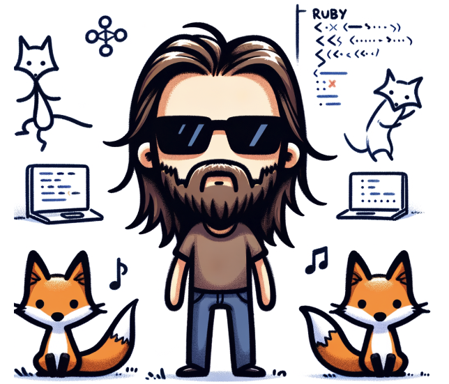

# Extending _why's Legacy



The leading mission for Scarpe has been to implement as much backwards compatibility as possible for _why's original
Shoes library. This remains true. _why's taste and DSL are celebrated and preserved. However, at the discretion of
core maintainers, new features may be added. They must be approved by Noah Gibbs or Nick Schwaderer, and described
in this file. They cannot conflict or damage backwards compatibility with the original Shoes library.

## Page Navigation

Similar to URL navigation. see `url_navigation_single_app.rb` for an example. Unlike URLs, they do not accept parameters,
only the name of the page. They are simply declared and named in blocks.

```ruby
Shoes.app do
  page(:home) do
    title "Home Page"
    para "Welcome to the home page"
    button "Go to another page" do
      visit(:another_page)
    end
  end

  page(:another_page) do
    title "Another Page"
    para "Welcome to another page"
    button "Go to home page" do
      visit(:home)
    end
  end
end
```

## Running a program in a process of its own

`Shoes.run_program(path, dir:, args:)` starts another Shoes program in a process of its own, on
the same Ruby and Scarpe, and returns a `Shoes::Program`: `pid`, `running?`, `stop`, and blocks for
its output, its errors and its end. A program that never stops freezes only itself. Approved by
Nick Schwaderer on 28 Sep 2026, for Hackety Hack's Run button, which in Shoes 3 evaluated a
child's program inside Hackety Hack. On the native display only; the others run the program
inside the app, as Shoes 3 did, with a warning. `docs/native.md` shows it in use, and
`native/DESIGN.md` 5.5 has the protocol.

```ruby
Shoes.app do
  button "Run" do
    @game = Shoes.run_program("game.rb")
    @game.on_error { |err| alert "#{err["message"]} (line #{err["line"]})" }
  end
  button("Stop") { @game&.stop }
end
```

## Putting text in at the caret

`edit_box.insert(text)` and `edit_line.insert(text)` put text in where the caret stands, over any
selection, as a paste would: one undo step, and the change block runs once it is in (ledger G18).
Proposed on 19 Oct 2026 and waiting on a maintainer's approval. With `drop`, below, a Markdown
editor puts a dropped picture where the writer was typing:

```ruby
Shoes.app do
  @notes = edit_box width: 400, height: 300
  drop { |path| @notes.insert("") }
end
```

## Dropping files on a window

`drop { |path| }`, on the app or any slot, gets the full path of each file dropped on the window
from Finder or a file manager, one call a file. Every `drop` block in the window hears it: the
native display is not told where the file landed (ledger H11). Proposed on 16 Oct 2026 and waiting
on a maintainer's approval. On the native display only; a webview never learns the path, so there
the block hears nothing. `scarpe peek --drop PATH` and Shoes-Spec's `drop_file(path)` drop one
without a window.

A packaged app built with `--opens` (a UTI such as `net.daringfireball.markdown`, or an
extension such as `md`) is offered by Finder's Open With for those files. Each file Finder hands
it, the one that launched it included, reaches the same `drop` blocks.

```ruby
Shoes.app do
  @name = para "Drop a file here"
  drop { |path| @name.text = File.basename(path) }
end
```

## `Shoes.on_error`

`Shoes.on_error { |err| }` hears every error a handler, a timer or the program's startup raises,
as a Hash with String keys (`class`, `message`, `backtrace`, `path`, `line`, `during`), besides
the log line and the Shoes console's entry. The program goes on as before. Approved by Nick
Schwaderer on 28 Sep 2026, so an app can show its own errors in its own words; Shoes 3 only put
them in its console.
